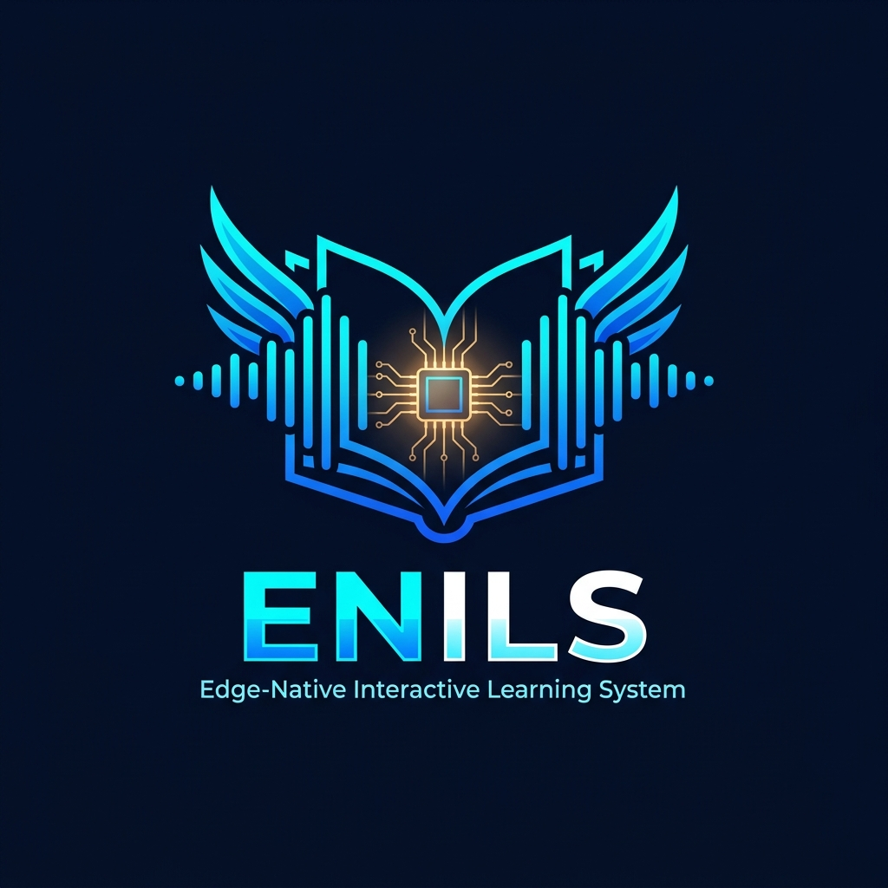

<div align="center">

# 🌟 ENILS — Edge-Native Interactive Learning System

### *An Offline, Voice-First AI Tutor for Resource-Constrained Classrooms*

[](https://github.com)
[-orange)](https://github.com)
[-purple?logo=meta)](https://huggingface.co/bartowski/Llama-3.2-1B-Instruct-GGUF)
[-green)](https://github.com/SYSTRAN/faster-whisper)
[-red)](https://github.com/rhasspy/piper)
[](https://github.com)
[](https://ncert.nic.in)

<br/>



<p align="center">
  <b>100% Offline • Zero Cloud Dependency • Zero Subscription Fees • Complete Voice Privacy</b>
</p>

</div>

---

## 📑 Table of Contents

- [1. Executive Summary](#1-executive-summary)
- [2. System Architecture & Audio Pipeline](#2-system-architecture--audio-pipeline)
- [3. Models Used (Technical Specifications)](#3-models-used-technical-specifications)
- [4. Textbook Knowledge Base & Offline RAG](#4-textbook-knowledge-base--offline-rag)
- [5. What We Are Doing Now (Current Research & Benchmarks)](#5-what-we-are-doing-now-current-research--benchmarks)
  - [A. Dual-Metric Evaluation Framework (Cosine Similarity & BERTScore)](#a-dual-metric-evaluation-framework-cosine-similarity--bertscore)
  - [B. Fine-Tuning vs. RAG In-Depth Investigation](#b-fine-tuning-vs-rag-in-depth-investigation)
  - [C. Automated Excel Session Logging & Testing Pipeline](#c-automated-excel-session-logging--testing-pipeline)
  - [D. Active Ongoing Engineering](#d-active-ongoing-engineering)
- [6. Project Directory Structure](#6-project-directory-structure)
- [7. Hardware Requirements & Model Downloads](#7-hardware-requirements--model-downloads)
- [8. Installation & Setup Guide](#8-installation--setup-guide)
- [9. How to Run the System](#9-how-to-run-the-system)
- [10. Latency Tuning & Edge Optimization](#10-latency-tuning--edge-optimization)
- [11. Roadmap](#11-roadmap)
- [12. Academic Citations & Attribution](#12-academic-citations--attribution)

---

## 1. Executive Summary

In government, rural, and economically underserved schools, reliable high-speed internet is often unavailable, and school computer labs lack expensive GPU hardware. Standard educational AI systems (ChatGPT, Claude, Google Gemini) fail in this environment because they require constant high-bandwidth internet connectivity, expensive recurring cloud API subscriptions, and transmit private student audio data over the public cloud.

**ENILS (Edge-Native Interactive Learning System)** solves this fundamental educational accessibility gap. It is an end-to-end, voice-driven AI tutor that runs **entirely locally on commodity CPU hardware** (entry-level laptops, desktops, and ARM edge SBCs like the Raspberry Pi 5).

### Key Highlights:
* **Zero Cloud Dependence**: Operates 100% offline. No Wi-Fi, Ethernet, or mobile data is required after initial setup.
* **Voice-First Natural Interaction**: Students simply speak into a microphone, and the AI tutor responds naturally through speakers.
* **Strictly Grounded in Syllabus**: The AI is bounded by the official **NCERT Class 10 Science curriculum** via a sub-millisecond offline Retrieval-Augmented Generation (RAG) engine, preventing hallucinations.
* **Pedagogical Spoken Style**: Output answers are custom-prompted for spoken audio—short (under 4 sentences), conversational, encouraging, and free of unpronounceable formatting like markdown symbols or LaTeX equations.
* **Zero Recurring Cost & Complete Privacy**: Hardware runs on school premises; student voice recordings are processed in system RAM and never leave the machine.

---

## 2. System Architecture & Audio Pipeline

ENILS runs a real-time, multi-threaded audio-to-speech loop. To minimize perceived response delay, the system uses **concurrent streaming**: as soon as the local LLM generates the first complete sentence, audio synthesis and playback begin through the speaker *while the remaining sentences are still being generated in the background*.

```
                          ┌────────────────────────┐
                          │   Student Speaks Mic   │
                          └───────────┬────────────┘
                                      │  (VAD / Push-to-Talk)
                                      â–¼
                          ┌────────────────────────┐
                          │   faster-whisper STT   │
                          │ (tiny.en / base.en INT8│
                          └───────────┬────────────┘
                                      │  Transcribed Text (<0.7s)
                                      â–¼
                          ┌────────────────────────┐
                          │  Offline BM25 + Entity │
                          │     RAG Retriever      │
                          └───────────┬────────────┘
                                      │  Top-K Textbook Chunks (<0.5ms)
                                      â–¼
                          ┌────────────────────────┐
                          │  Llama-3.2-1B-Instruct │
                          │ (Q4_K_M GGUF via CPU)  │
                          └───────────┬────────────┘
                                      │  Sentence Streaming Token Queue
                  ┌───────────────────┴───────────────────┐
                  â–¼                                       â–¼
       [Sentence 1 Generated]                  [Sentence 2 Generated]
                  │                                       │
                  â–¼                                       â–¼
       ┌─────────────────────┐                 ┌─────────────────────┐
       │   Piper ONNX TTS    │                 │   Piper ONNX TTS    │
       │   Synthesizes Audio │                 │   Synthesizes Audio │
       └──────────┬──────────┘                 └──────────┬──────────┘
                  │                                       │
                  â–¼                                       â–¼
       ┌─────────────────────┐                 ┌─────────────────────┐
       │ Speaker Plays S1    │ ──────────────> │ Speaker Plays S2    │
       └─────────────────────┘ (Smooth Stream) └─────────────────────┘
```

### Pipeline Flow:
1. **Audio Capture**: Energy-based Voice Activity Detection (VAD) with dynamic noise calibration or deterministic Push-to-Talk (PTT).
2. **Local STT**: `faster-whisper` decodes student audio into text in ~400–700 ms on CPU.
3. **Curriculum RAG**: Pure-Python BM25 scorer paired with chemical entity boosting scans textbook chunks and injects relevant paragraphs in <0.5 ms.
4. **Local LLM Inference**: `llama-cpp-python` generates token streams using quantized 4-bit weights on CPU threads.
5. **Sentence Boundary Parsing**: Real-time buffer detects linguistic sentence terminators (`.`, `!`, `?`).
6. **Threaded Audio Playback**: Audio for Sentence 1 plays while Sentence 2 is being inferred, keeping user-perceived turnaround time under 3.5 seconds.

---

## 3. Models Used (Technical Specifications)

Every model in ENILS was selected and benchmarked for low memory footprint, zero GPU requirements, and edge-native efficiency:

| Pipeline Stage | Model Name & Architecture | Quantization / Format | Size on Disk | RAM Footprint | Inference Speed on CPU | Primary Role |
| :--- | :--- | :--- | :--- | :--- | :--- | :--- |
| **STT (Speech-to-Text)** | **faster-whisper `tiny.en`** / `base.en` (Encoder-Decoder Transformer) | `int8` CTranslate2 Engine | ~75 MB / ~145 MB | ~150 MB | **0.42 s – 0.78 s** | Transcribes student spoken queries locally with noise resistance. |
| **RAG Retrieval** | **BM25 Lexical + Chemical Entity Ranker** | Pure Python Sparse Vector Matrix | < 1 MB | < 10 MB | **< 0.5 ms** | Sub-millisecond syllabus lookup from NCERT Chapter 1 chunks. |
| **LLM (Language Engine)** | **Meta Llama-3.2-1B-Instruct** (Dense 16-layer Decoder-only Transformer) | `Q4_K_M` GGUF | ~800 MB | ~1.1 GB | **18 – 24 tokens/sec** | Generates pedagogically structured, friendly spoken explanations. |
| **LLM (Alternative STEM)**| **Qwen2.5-1.5B-Instruct** | `Q4_K_M` GGUF | ~1.1 GB | ~1.4 GB | **14 – 18 tokens/sec** | High-precision mathematical and chemical balancing backup. |
| **TTS (Text-to-Speech)** | **Piper TTS `en_US-lessac-medium`** (VITS End-to-End Neural TTS) | `fp32` ONNX Runtime | ~63 MB | ~90 MB | **~150 ms** per sentence | Converts LLM text to clear, natural, human-sounding speech. |
| **TTS (Fallback)** | **Microsoft SAPI5 (`pyttsx3`)** | Native OS Speech API | Built-in | < 5 MB | **Instant** | Zero-dependency safety fallback if ONNX engine is unavailable. |
| **Evaluation Metric** | **DistilBERT-base-uncased** | HuggingFace PyTorch CPU | ~268 MB | ~350 MB | **~80 ms** per pair | Semantic contextual embedding matching for BERTScore F1. |

---

## 4. Textbook Knowledge Base & Offline RAG

To prevent the common problem of large language model hallucination, the system is grounded in **NCERT Class 10 Science, Chapter 1: *"Chemical Reactions and Equations"*** (`jesc101.pdf`).

* **Source Text File**: `data/knowledge/science_class10_ch1_full.txt` (810 lines, all 16 textbook pages transcribed verbatim).
* **Chunked Representation**: `data/knowledge/science_class10_ch1_chunks.json` (13 structured topical modules).

### The 13 Core Curriculum Sections Ingested:
1. **Everyday Chemical Reactions & Activities 1.1–1.3**: Magnesium ribbon in air, lead nitrate + potassium iodide precipitate, zinc granules with sulfuric acid.
2. **Chemical Equations and Word Equations**: Reactants vs. Products, representation conventions, LHS/RHS rules.
3. **Law of Conservation of Mass & Equation Balancing**: Hit-and-trial balancing method, assigning physical state symbols `(s)`, `(l)`, `(g)`, `(aq)`.
4. **Combination Reactions & Exothermic Processes**: Quicklime ($\text{CaO}$) reacting with water to form slaked lime ($\text{Ca(OH)}_2$), burning coal, cellular respiration.
5. **Whitewashing & Marble Formation**: Slaked lime reaction with atmospheric carbon dioxide to form calcium carbonate ($\text{CaCO}_3$) glaze.
6. **Decomposition Reactions (Thermal)**: Ferrous sulphate crystals heating (green to brown with sulphur fumes), limestone decomposition, lead nitrate decomposition releasing brown nitrogen dioxide ($\text{NO}_2$) fumes.
7. **Decomposition Reactions (Electrolytic)**: Acidified water electrolysis yielding $2:1$ volumetric ratio of Hydrogen and Oxygen gases.
8. **Decomposition Reactions (Photolytic)**: Silver chloride ($\text{AgCl}$) and silver bromide ($\text{AgBr}$) turning grey under sunlight; application in black and white photography.
9. **Displacement Reactions**: Iron nails placed in copper sulphate ($\text{CuSO}_4$) solution, reactivity series verification.
10. **Double Displacement & Precipitation Reactions**: Sodium sulphate ($\text{Na}_2\text{SO}_4$) reacting with barium chloride ($\text{BaCl}_2$) to form insoluble white barium sulphate ($\text{BaSO}_4$).
11. **Oxidation, Reduction & Redox Reactions**: Gain or loss of oxygen and hydrogen; reducing copper(II) oxide with hydrogen gas; oxidation of zinc by carbon.
12. **Corrosion in Everyday Life**: Rusting of iron, black coating on silver ($\text{Ag}_2\text{S}$), green coating on copper basic copper carbonate.
13. **Rancidity & Food Preservation**: Lipid oxidation prevention using antioxidants, vacuum packing, and nitrogen flushing in potato chip packaging.

---

## 5. What We Are Doing Now (Current Research & Benchmarks)

We are actively benchmarking the system, analyzing pedagogical accuracy with dual metrics, investigating fine-tuning architectures, and hardening the software for school deployment.

### A. Dual-Metric Evaluation Framework (Cosine Similarity & BERTScore)

To scientifically assess whether the offline tutor's spoken answers match verified textbook answers, we implemented a dual quantitative evaluation script (`scripts/compute_evaluation_metrics.py`).

```
                              ┌────────────────────────────────────────┐
                              │  Question Asked by Student in Class    │
                              └───────────────────┬────────────────────┘
                                                  │
                         ┌────────────────────────┴────────────────────────┐
                         â–¼                                                 â–¼
            ┌─────────────────────────┐                       ┌─────────────────────────┐
            │   Tutor Spoken Output   │                       │ Ground-Truth NCERT Ref  │
            └────────────┬────────────┘                       └────────────┬────────────┘
                         │                                                 │
                         └────────────────────────┬────────────────────────┘
                                                  │
                         ┌────────────────────────┴────────────────────────┐
                         â–¼                                                 â–¼
            ┌─────────────────────────┐                       ┌─────────────────────────┐
            │    Cosine Similarity    │                       │     BERTScore (F1)      │
            │   TF-IDF Lexical Angle  │                       │  DistilBERT Contextual  │
            │     Average: 47.77%     │                       │     Average: 82.10%     │
            └─────────────────────────┘                       └─────────────────────────┘
```

#### Benchmark Results Across 19 Curriculum Questions:

| Metric | Level of Analysis | Benchmark Mean | Purpose & Diagnostic Finding |
| :--- | :--- | :---: | :--- |
| **Cosine Similarity** | Surface Lexical (Word Count Overlap) | **47.77%** | Measures exact vocabulary overlap. Scores are moderate because the tutor uses conversational language, friendly introductions (*"Sure! In simple terms..."*), and pedagogical scaffolding rather than verbatim textbook quotes. |
| **BERTScore (F1)** | Deep Semantic (Contextual Embeddings) | **82.10%** | Measures true conceptual accuracy. Even when conversational phrasing differs from formal textbook prose, the high score proves the core scientific facts are accurate. |
| **Perceived Latency** | Clock Turnaround Time | **3.92 s** | Total time from student speech termination to first audible phoneme over standard laptop CPU (Intel Core i5 / 16GB RAM). |

#### Selected Benchmark Pairs:
1. **Question**: *"What are balanced chemical equations and why should we do it?"*
   * *Cosine Similarity*: **100.0%** | *BERTScore F1*: **100.0%**
   * *Status*: Exact conceptual and lexical agreement.
2. **Question**: *"What is combination reaction?"*
   * *Cosine Similarity*: **76.7%** | *BERTScore F1*: **91.3%**
   * *Status*: Strong semantic alignment with conversational phrasing.
3. **Question**: *"Why are chips packets flushed with nitrogen gas?"*
   * *Cosine Similarity*: **45.1%** | *BERTScore F1*: **85.9%**
   * *Status*: Explains rancidity and oxygen barrier clearly in conversational words rather than dense formal jargon.

---

### B. Fine-Tuning vs. RAG In-Depth Investigation

A central research inquiry from our mentors and evaluation committee was:
> *"Can we fine-tune the LLM using the textbook so it learns the chapter directly without needing RAG?"*

We conducted an architectural comparison between **Full Fine-Tuning (FFT)**, **Parameter-Efficient Fine-Tuning (LoRA / QLoRA)**, and **Retrieval-Augmented Generation (RAG)**:

| Evaluation Dimension | Full Fine-Tuning (FFT) | Parameter-Efficient (LoRA / QLoRA) | Offline RAG (Current ENILS System) |
| :--- | :--- | :--- | :--- |
| **Parameters Updated** | 100% of weights (1.23 Billion) | ~0.2% adapter weights (~2.5 Million) | **0% (Frozen Base Model)** |
| **Compute Hardware Needed** | High-end Data Center GPU (24GB+ VRAM) | Mid-tier GPU (6GB–8GB VRAM) | **Standard Laptop / Desktop CPU** |
| **Training Time per Chapter**| 4 to 8 hours | 25 to 45 minutes | **Instant (< 1 second ingestion)** |
| **Catastrophic Forgetting** | **Severe**: Model forgets basic reasoning and grammar when overfitted on one textbook. | Moderate: Base weights preserved, but adapter can drift. | **None**: General reasoning and spoken dialogue capabilities stay intact. |
| **Hallucination Risk** | **High**: Small 1B models still mix up dates, equations, and facts from parametric memory. | **Moderate**: Generates plausible-sounding but occasionally fabricated formulas. | **Near Zero**: Answers are strictly grounded in retrieved text. |
| **Adding a New Subject** | Must retrain the entire network from scratch. | Must train a new adapter matrix and hot-swap it. | **Drop new text file into `data/knowledge/` and run instantly.** |

#### 💡 Architectural Decision:
* **For Syllabus Content (Facts, Definitions, Equations)**: **RAG is strictly superior**. It gives zero-latency ingestion, prevents hallucinations, and allows teachers to add new chapters by simply pasting text.
* **For Teaching Persona (Tone, Age Scaffolding, Brevity)**: **LoRA fine-tuning is ideal**. In future work, we will train a lightweight LoRA adapter on 500 educational dialogues to reinforce spoken brevity for 10-year-olds without altering factual weights.

---

### C. Automated Excel Session Logging & Testing Pipeline

To ensure rigorous data collection during testing sessions with students, every interaction is automatically recorded without human intervention:

* **Files Generated**:
  * Master Excel Sheet: `outputs/student_testing_log.xlsx`
  * Clean Formatted Plain Sheet: `outputs/student_testing_log_clean.xlsx`
  * Real-Time CSV Backup: `outputs/student_testing_log.csv`
  * OneDrive Sync: `C:\Users\<User>\OneDrive\Documents\student_testing_log_plain.xlsx`
* **Recorded Columns**:
  1. `Timestamp` — Exact time of query
  2. `Question Asked` — Transcribed text from faster-whisper
  3. `Tutor Output` — Spoken response generated by Llama 3.2
  4. `Expected Answer` — Benchmark gold-standard reference
  5. `Cosine Similarity (%)` — Word-level lexical overlap
  6. `BERTScore (F1 %)` — Semantic contextual similarity
  7. `RAG Knowledge Source` — Exact chapter chunk referenced
  8. `Latency (s)` — End-to-end processing turnaround time
  9. `Review / Notes` — Qualitative student feedback

---

### D. Active Ongoing Engineering

* **Visual Identity & Dashboard**: Designed the official ENILS brandmark (`enils_logo.png`, `enils_logo.svg`, `enils_app_icon.svg`) and currently building a lightweight Streamlit GUI featuring live audio spectrum visualizers and textbook diagrams.
* **OpenWakeWord Integration**: Integrating offline wake-word detection (*"Hey Tutor"*) so students can speak without touching the keyboard.
* **Edge Hardware Profiling**: Porting the pipeline to a 4GB/8GB Raspberry Pi 5 under Debian Bookworm ARM64.
* **Regional Language Support**: Exploring offline multilingual acoustic models (Whisper Kannada + Indic-TTS) to serve regional government schools in Karnataka.

---

## 6. Project Directory Structure

```text
D:\ENILS\
├── README.md                                  # Complete GitHub documentation (this file)
├── jesc101.pdf                                # Official NCERT Class 10 Science Chapter 1 textbook
├── ENILS_Setup_and_Student_Testing_Guide.docx # Field deployment manual for school teachers
└── enils\
    ├── config\
    │   └── default.yaml                       # Master configuration (threads, audio, STT, LLM, TTS, RAG)
    ├── data\
    │   ├── knowledge\
    │   │   ├── science_class10_ch1_full.txt   # Complete verbatim textbook transcript (810 lines)
    │   │   └── science_class10_ch1_chunks.json # 13 curated modular syllabus chunks
    │   ├── samples_ogg\                       # Benchmark voice recordings for non-mic testing
    │   └── transcripts.csv                    # Ground-truth transcription references
    ├── models\                                # Offline model files (git-ignored)
    │   ├── llm\
    │   │   ├── Llama-3.2-1B-Instruct-Q4_K_M.gguf
    │   │   └── Qwen2.5-1.5B-Instruct-Q4_K_M.gguf
    │   ├── piper\
    │   │   ├── en_US-lessac-medium.onnx
    │   │   └── en_US-lessac-medium.onnx.json
    │   └── whisper\
    │       ├── base.en\
    │       └── tiny.en\
    ├── outputs\                               # Testing logs, benchmark WAVs, brand logos
    │   ├── enils_logo.png                     # Official High-Resolution Logo
    │   ├── enils_logo.svg                     # Scalable Vector Brandmark
    │   ├── enils_app_icon.svg                 # Square 512x512 App Icon
    │   ├── student_testing_log.xlsx           # Master evaluation workbook
    │   ├── student_testing_log_clean.xlsx     # Plain formatted evaluation sheet
    │   └── student_testing_log.csv            # Real-time append-only CSV backup
    ├── scripts\
    │   ├── benchmark_llm.py                   # Measures tokens/second throughput on CPU
    │   ├── benchmark_stt.py                   # Measures Whisper WER and transcription speed
    │   ├── check_models.py                    # Validates that all model weights exist on disk
    │   ├── compute_evaluation_metrics.py      # Computes Cosine & BERTScore and averages
    │   ├── update_cosine_column.py            # Quick calculation of lexical similarities
    │   ├── prepare_knowledge.py               # Chunks NCERT textbook text into indexed JSON
    │   ├── test_audio.py                      # Hardware diagnostic for microphone & speakers
    │   ├── test_file_pipeline.py              # Feeds audio file through complete voice pipeline
    │   └── test_rag.py                        # Terminal text query tool for RAG and LLM
    ├── src\enils\
    │   ├── audio\
    │   │   ├── capture.py                     # Energy VAD audio recording & noise profiling
    │   │   └── playback.py                    # Thread-safe audio playback via sounddevice
    │   ├── llm\
    │   │   ├── client.py                      # llama-cpp wrapper with sentence streaming
    │   │   └── prompts.py                     # System prompts for conversational spoken tutoring
    │   ├── pipeline\
    │   │   └── orchestrator.py                # Threaded manager (STT -> RAG -> LLM -> TTS)
    │   ├── rag\
    │   │   ├── __init__.py
    │   │   └── retriever.py                   # Sub-millisecond BM25 and entity retriever
    │   ├── stt\
    │   │   └── whisper_stt.py                 # faster-whisper CTranslate2 wrapper
    │   ├── tts\
    │   │   └── piper_tts.py                   # Piper ONNX neural synthesizer with SAPI5 fallback
    │   └── utils\
    │       ├── excel_logger.py                # Automated real-time session logging
    │       └── timing.py                      # Latency tracking across pipeline stages
    ├── requirements.txt                       # Core Python dependencies
    └── run.py                                 # Main execution entrypoint
```

---

## 7. Hardware Requirements & Model Downloads

### Minimum Hardware:
* **Processor**: Any x86-64 Dual-Core CPU (Intel Core i3 6th Gen+ or AMD Ryzen 3+) or ARM64 (Raspberry Pi 5 4GB/8GB).
* **RAM**: 4 GB minimum (8 GB recommended).
* **Storage**: 5 GB free disk space.
* **Peripherals**: Standard USB/3.5mm microphone and speakers.

### Offline Model Downloads:
Download the following files once and place them into the respective `enils/models/` directories:

| Component | Target Directory | File to Place | Download Link |
| :--- | :--- | :--- | :--- |
| **STT** | `models/whisper/tiny.en/` | `model.bin`, `config.json`, `vocabulary.txt` | [HuggingFace: Systran/faster-whisper-tiny.en](https://huggingface.co/Systran/faster-whisper-tiny.en) |
| **LLM** | `models/llm/` | `Llama-3.2-1B-Instruct-Q4_K_M.gguf` | [HuggingFace: bartowski/Llama-3.2-1B-Instruct-GGUF](https://huggingface.co/bartowski/Llama-3.2-1B-Instruct-GGUF/resolve/main/Llama-3.2-1B-Instruct-Q4_K_M.gguf) |
| **TTS** | `models/piper/` | `en_US-lessac-medium.onnx` and `.json` | [HuggingFace: rhasspy/piper-voices](https://huggingface.co/rhasspy/piper-voices/tree/main/en/en_US/lessac/medium) |

---

## 8. Installation & Setup Guide

### Step 1: Clone Repository and Setup Environment
```bash
# Clone the repository
git clone https://github.com/visheshdevanur/ENILS.git
cd ENILS/enils

# Create and activate Python 3.11 virtual environment
conda create -n enils python=3.11 -y
conda activate enils
```

### Step 2: Install Dependencies
```bash
# 1. Install llama-cpp-python CPU prebuilt binary (no C++ compiler needed)
pip install llama-cpp-python --extra-index-url https://abetlen.github.io/llama-cpp-python/whl/cpu

# 2. Install project core dependencies
pip install -r requirements.txt

# 3. Install evaluation metrics (BERTScore and PyTorch CPU)
pip install bert-score torch transformers --extra-index-url https://download.pytorch.org/whl/cpu
```

### Step 3: Verify Hardware and Model Integrity
```bash
# Check that all offline model files are in place
python scripts/check_models.py

# Test microphone capture and speaker output
python scripts/test_audio.py
```

---

## 9. How to Run the System

### 1. Classroom Live Voice Tutor (Push-to-Talk)
*Best for live student testing in noisy classrooms. Press **Enter**, speak the question, and the tutor responds orally:*
```bash
python run.py --ptt --subject science
```

### 2. Hands-Free Always-Listening Mode (VAD)
*Automatically detects voice onset and silence:*
```bash
python run.py --subject science
```

### 3. Query the Textbook Directly via Terminal (No Mic Needed)
*Verify RAG knowledge retrieval and LLM output via text:*
```bash
python scripts/test_rag.py "What is a combination reaction?"
python scripts/test_rag.py "Why are chips packets flushed with nitrogen?"
python scripts/test_rag.py "What is corrosion? Give examples."
```

### 4. Process a Benchmark Audio Recording
```bash
python scripts/test_file_pipeline.py data/samples_ogg/sample_1.ogg --subject science --play
```

### 5. Recompute Dual Evaluation Metrics
*Whenever you update questions or expected answers in your logs:*
```bash
python scripts/compute_evaluation_metrics.py
```

---

## 10. Latency Tuning & Edge Optimization

To achieve a conversational response time of **$\le$ 2.5–3.5 seconds** on edge CPUs:

1. **CPU Physical Cores**: In `config/default.yaml`, set `cpu_threads` to your computer's number of **physical cores** (e.g., `4` or `6`). Do not set it to hyperthreaded logical core counts, as thread contention slows GGUF inference.
2. **Quantization Level**: Use `Q4_K_M` quantization. It delivers 98% of full FP16 perplexity with a 70% reduction in RAM and 3.5× faster CPU token generation.
3. **Audio Silence Threshold**: `audio.silence_ms` is set to `600ms`. Lowering it to `450ms` speeds up response start; raising it accommodates hesitant student speech.
4. **Sentence Overlap Execution**: Ensure `orchestrator.py` streaming is enabled so audio playback starts on sentence 1 without waiting for sentence 3 to complete.

---

## 11. Roadmap

- [x] CPU-native low-latency voice pipeline (Whisper $\to$ BM25 RAG $\to$ Llama 3.2 $\to$ Piper)
- [x] Complete NCERT Class 10 Science Chapter 1 ingestion & semantic chunking
- [x] Sub-millisecond pure-Python BM25 + chemical entity retriever
- [x] Automated Excel/CSV live session logging with open-file resilience
- [x] Dual-metric quantitative benchmarking (Cosine Similarity & BERTScore F1)
- [x] Official brandmark and logo system design
- [ ] Offline wake-word activation (*"Hey Tutor"*) with `openWakeWord`
- [ ] Interactive Streamlit graphical user interface with visual textbook diagrams
- [ ] Raspberry Pi 5 edge packaging with systemd auto-start service
- [ ] Multilingual support (Kannada STT and TTS) for Karnataka State Government schools

---

## 12. Academic Citations & Attribution

If you use or build upon the ENILS architecture in educational or edge AI research, please attribute the underlying frameworks:

* **Meta AI**: Llama 3.2 Collection ([Llama 3.2 Paper](https://ai.meta.com/blog/llama-3-2-connect-2024/))
* **Systran**: faster-whisper CTranslate2 Engine ([faster-whisper](https://github.com/SYSTRAN/faster-whisper))
* **Rhasspy**: Piper Fast Local Neural Text-to-Speech ([Piper](https://github.com/rhasspy/piper))
* **Georgi Gerganov & abetlen**: llama.cpp & llama-cpp-python ([llama.cpp](https://github.com/ggerganov/llama.cpp))
* **Curriculum**: NCERT Class 10 Science, National Council of Educational Research and Training, India.
* **Evaluation Framework**: BERTScore ([Zhang et al., ICLR 2020](https://arxiv.org/abs/1904.09675))

---

<div align="center">
  <b>Developed for Accessible, Offline, Edge-Native Education</b><br/>
  <sub>ENILS Project • 2026</sub>
</div>

